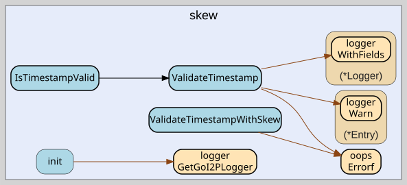

# skew
--
    import "github.com/go-i2p/go-i2p/lib/util/time/skew"



Package skew provides helpers for validating timestamps against an
acceptable clock skew window.

## What is clock skew?

Every machine has its own clock, and no two clocks are perfectly in sync.
The difference between two machines' clocks is called clock skew. On the
I2P network, routers exchange messages that carry timestamps (for example,
the "published" time inside a RouterInfo). If a router's clock is badly
wrong, it can publish timestamps that look far in the future or far in the
past.

## Why does this matter?

Timestamps are used to decide which data is fresh and which is stale, and
to defend against replay attacks (resenting an old message as if it were
new). If a router accepted timestamps that were wildly off, it could be
tricked into using stale data or accepting forged messages. So routers
reject timestamps that fall outside an acceptable skew window.

## How it works

ValidateTimestamp compares a published timestamp against the current time
and rejects it if the difference exceeds MaxClockSkew (60 minutes) in
either direction. The 60-minute bound is go-i2p's implementation
convention for RouterInfo validation; the I2P specification itself
specifies tighter per-protocol windows (for example, NTCP2 treats a skew
greater than +/- 60 seconds as generally fatal, and SSU2 recommends
+/- 2 minutes for DateTime blocks). Use ValidateTimestampWithSkew to apply
a different window where a subsystem needs one.

Usage:

    // Reject a RouterInfo whose published time is more than 60 minutes off.
    if err := skew.ValidateTimestamp(routerInfo.Published); err != nil {
        return err
    }

    // Apply a tighter window, e.g. for a handshake timestamp.
    if err := skew.ValidateTimestampWithSkew(ts, 2*time.Minute); err != nil {
        return err
    }

## See also

- NTCP2 specification (clock skew guidelines): https://github.com/i2p/i2p.www/blob/master/i2p2www/spec/ntcp2.rst
- SSU2 specification (DateTime block skew): https://github.com/i2p/i2p.www/blob/master/i2p2www/spec/ssu2.rst
- Common structures (RouterInfo): https://github.com/i2p/i2p.www/blob/master/i2p2www/spec/common-structures.rst

## Usage

```go
const MaxClockSkew = 60 * time.Minute
```
MaxClockSkew is the maximum acceptable difference between a RouterInfo's
published timestamp and the current time. The 60-minute threshold is
go-i2p's implementation convention for RouterInfo validation; the I2P
specification specifies tighter per-protocol windows (see the package
documentation for the NTCP2 and SSU2 references).

#### func  IsTimestampValid

```go
func IsTimestampValid(published time.Time) bool
```
IsTimestampValid is a convenience wrapper around ValidateTimestamp that returns
a boolean instead of an error. It returns true if the timestamp is within the
acceptable clock skew window.

#### func  ValidateTimestamp

```go
func ValidateTimestamp(published time.Time) error
```
ValidateTimestamp checks whether the given timestamp is within the acceptable
clock skew window (±MaxClockSkew from the current time). It returns nil if the
timestamp is valid, or a descriptive error if it falls outside the window.

A zero-value time.Time is always rejected as invalid.

It delegates to ValidateTimestampWithSkew with the MaxClockSkew constant.

#### func  ValidateTimestampWithSkew

```go
func ValidateTimestampWithSkew(published time.Time, maxSkew time.Duration) error
```
ValidateTimestampWithSkew checks whether the given timestamp is within a custom
clock skew window. This is useful for subsystems that need different tolerances
(e.g., NTCP2 handshake uses ±2 minutes).

A zero-value time.Time is always rejected. A non-positive maxSkew is rejected
with an error.


skew 

github.com/go-i2p/go-i2p/lib/util/time/skew

[go-i2p template file](template.md)
